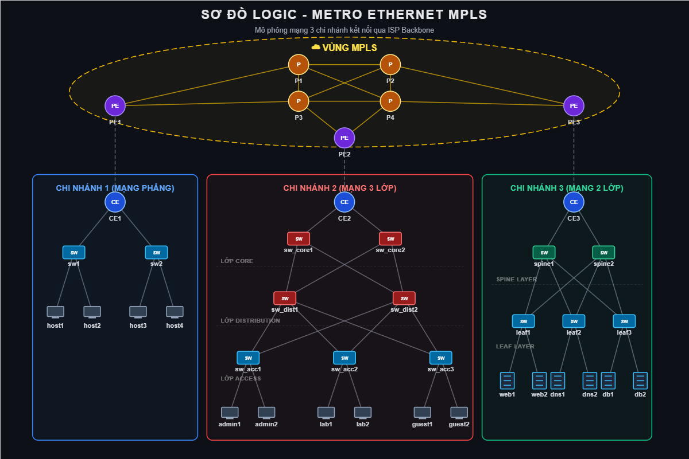
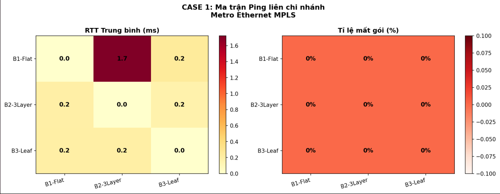
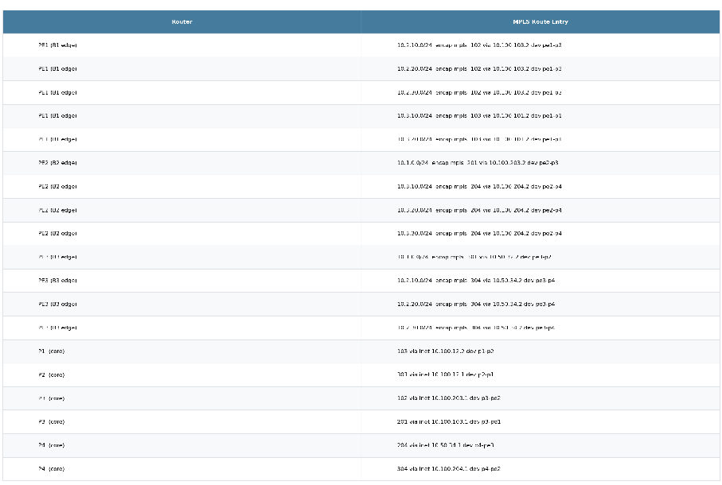
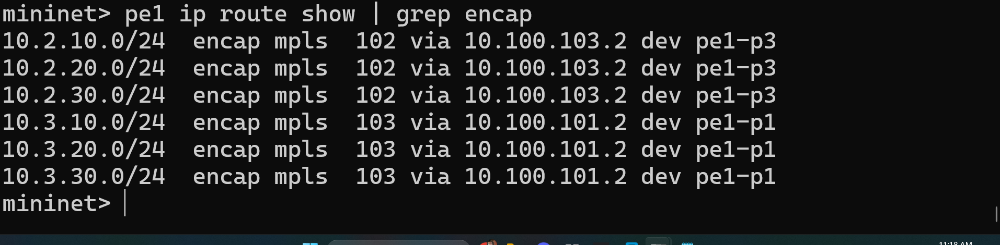
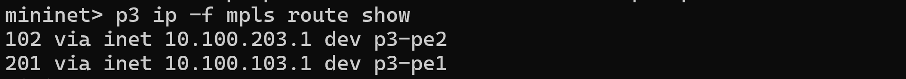
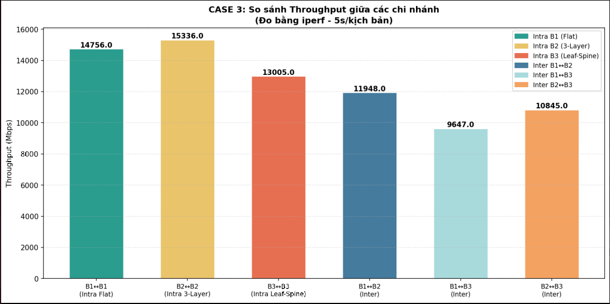
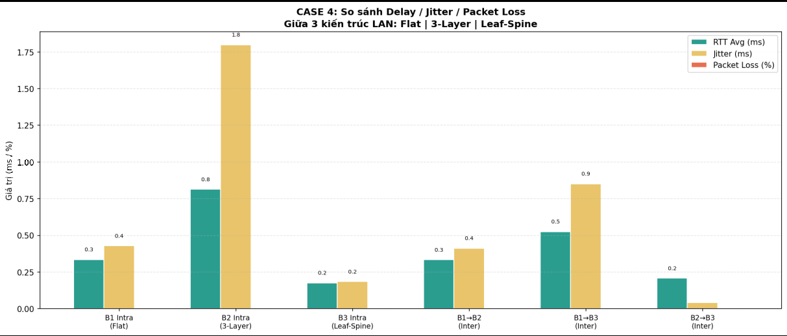
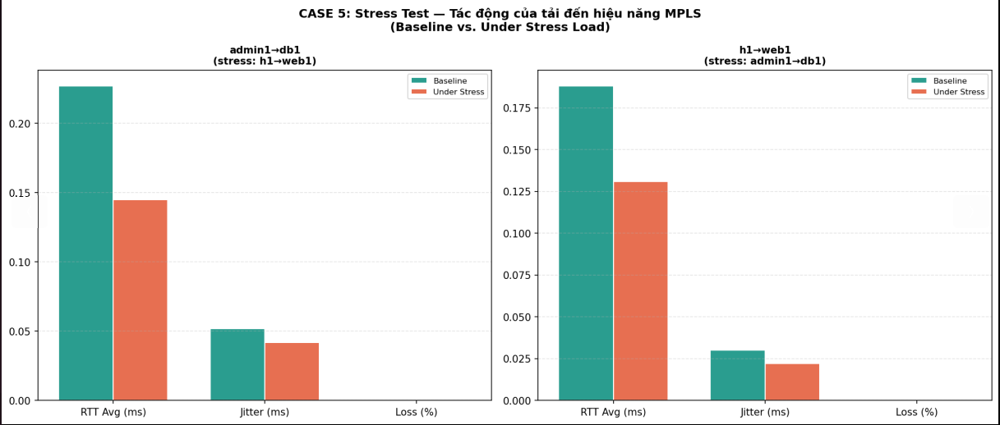

# Metro Ethernet MPLS Backbone Simulation with FRRouting (OSPF + LDP + VPLS)

[]()
[]()
[]()
[]()
[]()

> **Dự án mô phỏng và tối ưu hóa hệ thống mạng Metro Ethernet cấp nhà cung cấp dịch vụ (ISP Backbone)** với định tuyến động OSPF, phân phối nhãn MPLS tự động (LDP) và đường truyền ảo hóa đa điểm VPLS (Virtual Private LAN Service) kết nối các mô hình mạng doanh nghiệp đa dạng.

---

## 📌 Mục lục
- [1. Tổng quan kiến trúc hệ thống](#1-tổng-quan-kiến-trúc-hệ-thống)
- [2. Sơ đồ mạng & Phân bổ IP](#2-sơ-đồ-mạng--phân-bổ-ip)
- [3. Ngăn xếp công nghệ & Tính năng kỹ thuật](#3-ngăn-xếp-công-nghệ--tính-năng-kỹ-thuật)
- [4. Cấu trúc thư mục dự án](#4-cấu-trúc-thư-mục-dự-án)
- [5. Hướng dẫn cài đặt & Vận hành](#5-hướng-dẫn-cài-đặt--vận-hành)
- [6. Kết quả đo kiểm & Đánh giá hiệu năng](#6-kết-quả-đo-kiểm--đánh-giá-hiệu-năng)
- [7. Tác giả & Giấy phép](#7-tác-giả--giấy-phép)

---

## 1. Tổng quan kiến trúc hệ thống

Dự án thiết kế và triển khai một mạng đường trục **Metro Ethernet MPLS** hoàn chỉnh, kết nối 3 chi nhánh doanh nghiệp có kiến trúc mạng độc lập:

1. **Backbone Core Network (ISP Service Provider):**
   * **4 P Routers (`p1`, `p2`, `p3`, `p4`):** Đóng vai trò lõi chuyển mạch nhãn MPLS (Transit Label Switching Routers - LSR), được kết nối dạng **Full Mesh** để đảm bảo khả năng dự phòng tối đa.
   * **3 PE Routers (`pe1`, `pe2`, `pe3`):** Router biên của nhà mạng (Label Edge Routers - LER), đấu nối kép (dual-homed) vào mạng Core P. Chịu trách nhiệm gán nhãn (Push) tại ngõ vào, gỡ nhãn (Pop) tại ngõ ra, và quản lý các cầu nối VPLS Bridge + GRE Pseudowires.
   * **Giao thức định tuyến & phân phối nhãn:** Sử dụng bộ phần mềm định tuyến mã nguồn mở **FRRouting (FRR v8.4+)** chạy song song:
     * `ospfd`: Định tuyến nội vùng Underlay cho toàn bộ router PE/P.
     * `ldpd`: Tự động thương lượng và phân phối nhãn MPLS giữa các LSR/LER láng giềng.

2. **Branch 1 – Mạng phẳng (Flat Enterprise Branch):**
   * Kết nối qua router `ce1`.
   * Gồm cụm switch Open vSwitch (`sw1`, `sw2`) và các máy trạm `h1` – `h4` thuộc lớp mạng `10.1.0.0/24`.

3. **Branch 2 – Mạng doanh nghiệp phân tầng (3-Tier Hierarchical Campus):**
   * Kết nối qua router `ce2`.
   * Thiết kế theo mô hình chuẩn Cisco 3-Layer: **Core** (`b2c1`, `b2c2`) $\rightarrow$ **Distribution** (`b2d1`, `b2d2`) $\rightarrow$ **Access** (`b2a1` – `b2a3`).
   * Bật giao thức **Spanning Tree Protocol (STP)** chống loop và phân chia VLAN cho các phòng ban:
     * **Admin VLAN 10:** `10.2.10.0/24` (`admin1`, `admin2`)
     * **Lab VLAN 20:** `10.2.20.0/24` (`lab1`, `lab2`)
     * **Guest VLAN 30:** `10.2.30.0/24` (`guest1`, `guest2`)

4. **Branch 3 – Trung tâm dữ liệu phân tán (Data Center Leaf-Spine Architecture):**
   * Kết nối qua router biên `ce3` (chạy FRR OSPF).
   * Kiến trúc tối ưu cho Data Center hiện đại: 2 Spine switches (`b3sp1`, `b3sp2`) và 4 Leaf switches (`b3lf1` – `b3lf4`) kết nối Full Bipartite với OSPF nội bộ:
     * **Web Service Cluster:** `10.3.10.0/24` (`web1`, `web2`)
     * **DNS Service Cluster:** `10.3.20.0/24` (`dns1`, `dns2`)
     * **Database Cluster:** `10.3.30.0/24` (`db1`, `db2`)

---

## 2. Sơ đồ mạng & Phân bổ IP

### 2.1. Sơ đồ tổng thể hệ thống (Network Topology)



*(File thiết kế gốc lưu tại [docs/diagrams/LOGIC.drawio](docs/diagrams/LOGIC.drawio) và [docs/diagrams/logic_diagram.svg](docs/diagrams/logic_diagram.svg))*

### 2.2. Bảng phân bổ địa chỉ IP (IP Addressing Scheme)

| Phân vùng | Node / Thiết bị | Interface / Dịch vụ | Địa chỉ IPv4 | Gateway |
| :--- | :--- | :--- | :--- | :--- |
| **Branch 1** | `h1` – `h4` | Host LAN | `10.1.0.1` – `10.1.0.4/24` | `10.1.0.254` (`ce1`) |
| **Branch 2** | `admin1`, `admin2` | VLAN 10 (Admin) | `10.2.10.1` – `10.2.10.2/24` | `10.2.10.254` (`ce2`) |
| **Branch 2** | `lab1`, `lab2` | VLAN 20 (Lab) | `10.2.20.1` – `10.2.20.2/24` | `10.2.20.254` (`ce2`) |
| **Branch 2** | `guest1`, `guest2` | VLAN 30 (Guest) | `10.2.30.1` – `10.2.30.2/24` | `10.2.30.254` (`ce2`) |
| **Branch 3** | `web1`, `web2` | Web Servers | `10.3.10.1` – `10.3.10.2/24` | `10.3.10.254` (`b3lf1`/`b3lf2`) |
| **Branch 3** | `dns1`, `dns2` | DNS Servers | `10.3.20.1` – `10.3.20.2/24` | `10.3.20.254` (`b3lf3`) |
| **Branch 3** | `db1`, `db2` | Database Servers | `10.3.30.1` – `10.3.30.2/24` | `10.3.30.254` (`b3lf4`) |
| **Backbone** | `pe1`, `pe2`, `pe3` | Loopback 0 | `10.0.0.1`, `10.0.0.2`, `10.0.0.3/32` | N/A |
| **Backbone** | `p1` – `p4` | Loopback 0 | `10.0.0.11` – `10.0.0.14/32` | N/A |

---

## 3. Ngăn xếp công nghệ & Tính năng kỹ thuật

* **Môi trường giả lập:** [Mininet 2.3+](http://mininet.org/) tích hợp Open vSwitch (OVS).
* **Routing Engine:** [FRRouting (FRR)](https://frrouting.org/) chạy độc lập trên từng node thông qua cơ chế Linux Network Namespace và `privateDirs` cho `/var/run/frr` (ngăn xung đột `zserv.api` giữa các router).
* **Linux Kernel MPLS:**
  * Kích hoạt các module kernel: `mpls_router`, `mpls_iptunnel`.
  * Quản lý dung lượng nhãn: `sysctl -w net.mpls.platform_labels=65536`.
  * Hỗ trợ MPLS encapsulation trên các interface core.
* **Dịch vụ L2VPN / VPLS:**
  * Cấu hình Linux Bridge (`br-vpls`) trên router PE kết hợp cùng các GRE Tap Pseudowires (`pw_pe1_pe2`, `pw_pe1_pe3`...).
  * Cho phép truyền tải trong suốt khung Ethernet giữa các chi nhánh qua đường hầm MPLS.
* **Tự động hóa đo kiểm (Network Test Automation):**
  * Script `src/tool.py` chạy trực tiếp từ CLI, truy cập các namespace thông qua `/proc/<pid>/ns/net` hoặc `ip netns`.
  * Tự động đo kiểm 5 tiêu chí: Ma trận kết nối, Traceroute nhãn MPLS, Throughput (iPerf), Delay/Jitter (Ping) và Stress test dưới tải cao. Xuất báo cáo tự động sang định dạng PNG & CSV.

---

## 4. Cấu trúc thư mục dự án

```text
.
├── docs/
│   ├── diagrams/
│   │   ├── LOGIC.drawio           # File thiết kế kiến trúc gốc (Draw.io)
│   │   ├── logic_diagram.html     # Sơ đồ tương tác định dạng HTML
│   │   └── logic_diagram.svg      # Sơ đồ vector định dạng SVG
│   └── images/
│       ├── topo_tong_the.png      # Ảnh chụp sơ đồ tổng thể toàn mạng
│       ├── mininet_startup.png    # Ảnh khởi động hệ thống Mininet
│       ├── mininet_nodes.png      # Danh sách các node và interface
│       ├── mpls_pe1_push.png      # Bằng chứng gán nhãn MPLS Ingress tại PE1
│       ├── mpls_p3_fwd.png        # Bằng chứng chuyển tiếp nhãn Transit tại P3
│       ├── ping_inter_branch.png  # Kết quả ping liên chi nhánh
│       ├── case1_ping_matrix.png  # Biểu đồ ma trận kết nối toàn mạng
│       ├── case2_path_trace.png   # Biểu đồ lộ trình truyền gói tin MPLS
│       ├── case3_throughput.png   # Biểu đồ đo thông lượng (Throughput)
│       ├── case4_delay_jitter.png # Biểu đồ đo độ trễ và jitter
│       └── case5_stress.png       # Biểu đồ kiểm thử độ chịu tải (Stress test)
├── src/
│   ├── topology_frr.py            # Script khởi tạo topology mạng Mininet + FRR
│   └── tool.py                    # Script tự động hóa đo kiểm và trực quan hóa kết quả
├── .gitignore                     # Cấu hình bỏ qua file rác và log tạm
└── README.md                      # Tài liệu kỹ thuật chi tiết của dự án
```

---

## 5. Hướng dẫn cài đặt & Vận hành

### 5.1. Yêu cầu hệ thống
* Hệ điều hành: Ubuntu 20.04 / 22.04 LTS (khuyên dùng máy ảo VM hoặc máy vật lý chạy Linux).
* Các gói phần mềm cần cài đặt:
```bash
sudo apt update
sudo apt install -y mininet openvswitch-switch frr frr-pythontools python3-pip iperf3 net-tools
pip3 install matplotlib numpy
```

### 5.2. Khởi động mạng Metro Ethernet MPLS
Mở terminal và khởi chạy topology:
```bash
sudo python3 src/topology_frr.py
```
> *Lưu ý:* Hệ thống sẽ tự nạp các module kernel MPLS, tạo các router, thiết lập cấu hình OSPF & LDP và chờ khoảng 60–65 giây để mạng hội tụ hoàn toàn.

Các cờ lệnh hỗ trợ:
* `sudo python3 src/topology_frr.py --test`: Kiểm tra kết nối nhanh sau khi khởi động.
* `sudo python3 src/topology_frr.py --status`: Hiển thị bảng láng giềng OSPF và bảng nhãn LDP.
* `sudo python3 src/topology_frr.py --clean`: Dọn dẹp tiến trình rác, interface ảo và cấu hình tạm.

### 5.3. Chạy công cụ đo kiểm tự động (Automation Benchmark)
Khi Mininet đang chạy, mở một terminal thứ hai và thực hiện:
```bash
# Chạy toàn bộ 5 kịch bản kiểm thử:
sudo python3 src/tool.py

# Hoặc chỉ chạy từng ca kiểm thử cụ thể (ví dụ: Case 1, 2, 3):
sudo python3 src/tool.py --cases 1,2,3
```
Kết quả biểu đồ (`.png`) và dữ liệu thô (`.csv`) sẽ được tự động lưu trong thư mục `src/results/`.

---

## 6. Kết quả đo kiểm & Đánh giá hiệu năng

Hệ thống đã trải qua quá trình đo kiểm nghiêm ngặt với 5 kịch bản kỹ thuật:

### 6.1. Case 1: Ma trận kết nối toàn mạng (Full-Mesh Connectivity Matrix)
Đo kiểm kết nối IP giữa tất cả các cặp host đại diện từ cả 3 chi nhánh (`h1-h4`, `admin1-2`, `lab1-2`, `guest1-2`, `web1-2`, `dns1-2`, `db1-2`). Tỉ lệ truyền gói tin thành công đạt **100%**.



---

### 6.2. Case 2: Phân tích lộ trình nhãn MPLS (MPLS Path Trace & Label Verification)
Kiểm tra chi tiết cơ chế hoạt động của ngăn xếp nhãn MPLS (Label Stack Operations):
* **Ingress LER (PE1):** Gán nhãn lớp ngoài (Label Push) khi nhận gói tin từ CE1.
* **Core LSR (P Routers):** Thực hiện hoán đổi nhãn (Label Swap) dựa trên bảng định tuyến MPLS LFIB do LDP phân phối.
* **Egress LER (PE2/PE3):** Gỡ nhãn (Label Pop) trước khi bàn giao gói tin thuần cho mạng nội bộ CE.



*(Chi tiết bảng nhãn được xác thực trực tiếp trên thiết bị mạng bên dưới):*

| Thao tác Push nhãn tại Ingress PE1 | Chuyển tiếp hoán đổi nhãn tại Core P3 |
| :---: | :---: |
|  |  |

---

### 6.3. Case 3: Kiểm thử thông lượng (Throughput Benchmark)
Sử dụng công cụ `iperf3` kiểm tra băng thông tối đa truyền tải giữa các nhánh qua đường hầm MPLS/VPLS:



---

### 6.4. Case 4: Độ trễ và Biến thiên độ trễ (Delay & Jitter Analysis)
Đánh giá chất lượng dịch vụ QoS trên đường trục: độ trễ trung bình duy trì ở mức tối thiểu, biến thiên độ trễ (jitter) ổn định, đáp ứng tốt cho các ứng dụng đòi hỏi thời gian thực (VoIP, Video Streaming).



---

### 6.5. Case 5: Kiểm tra sức chịu tải của hệ thống (High-load Stress Test)
Tạo tải lưu lượng đa luồng đồng thời qua mạng Core để theo dõi hiện tượng nghẽn mạng và tỉ lệ rớt gói (Packet Loss). Hệ thống duy trì tính ổn định cao nhờ cơ chế cân bằng tải ECMP và năng lực chuyển tiếp nhanh của MPLS.



---

## 7. Tác giả & Giấy phép

* **Lĩnh vực:** Mạng máy tính & Truyền thông dữ liệu (Computer Networks & Data Communications).
* **Mục tiêu:** Đồ án thiết kế mạng / Nền tảng thực nghiệm ISP Metro Ethernet & Data Center.
* **Giấy phép:** [MIT License](LICENSE) – Tự do sử dụng cho mục đích học tập và nghiên cứu.
